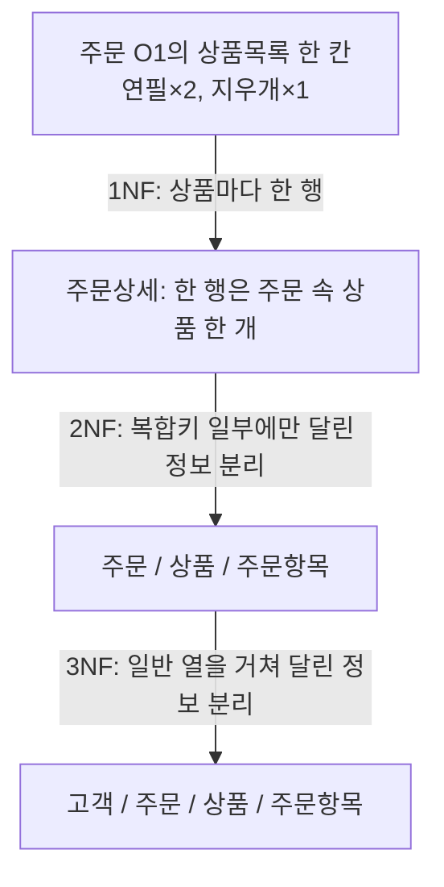

# 정규화: 1NF → 2NF → 3NF

[[00-학습-허브]] · [[01-데이터베이스]] · [[06-오답-복습]]

**정규화**는 한 사실을 여러 행에 반복 저장해서 생기는 삽입·수정·삭제 문제를 줄이도록 테이블을 나누는 과정이다. 테이블을 나누면 필요한 정보를 함께 조회할 때 `JOIN`이 필요할 수 있다.



## 1NF: 한 칸에 한 값

`상품목록 = "연필×2, 지우개×1"`처럼 **한 칸에 여러 상품을 목록으로 넣지 않는다.** 상품마다 행을 만든다.

| 주문번호 | 상품번호 | 고객번호 | 고객명 | 상품명 | 수량 |
|---|---|---|---|---|---:|
| O1 | P1 | C1 | 민수 | 연필 | 2 |
| O1 | P2 | C1 | 민수 | 지우개 | 1 |
| O2 | P1 | C1 | 민수 | 연필 | 3 |

이 예시에서 한 행을 구별하려면 **(주문번호, 상품번호)**가 필요하다. 이것이 복합키다. 시험에서는 1NF를 “각 칸에 원자적 값”으로 설명한다. 어떤 값이 원자적인지는 데이터의 사용 목적에 따라 판단한다.

## 2NF와 부분 종속

위 표의 기본키를 `(주문번호, 상품번호)`라고 하면 다음과 같다.

```text
상품번호 → 상품명
주문번호 → 고객번호, 고객명
(주문번호, 상품번호) → 수량
```

`상품명`은 **상품번호만**으로, `고객번호`는 **주문번호만**으로 정해진다. 복합키 전체가 필요하지 않은 정보를 분리한다.

```text
주문(주문번호, 고객번호, 고객명)
상품(상품번호, 상품명)
주문항목(주문번호, 상품번호, 수량)
```

`수량`은 같은 상품이라도 주문마다 달라진다. 따라서 **상품 테이블이 아니라 주문항목 테이블**에 둔다. 예를 들어 P1이 O1에서는 2개, O2에서는 3개일 수 있다.

## 3NF: 일반 열을 거쳐 의존하는 정보 분리

2NF까지 분리한 `주문`에는 `주문번호 → 고객번호 → 고객명`이 남는다. 고객명이 주문번호에서 **고객번호를 거쳐** 정해지는 이행 종속이다. 같은 고객이 여러 번 주문하면 고객명이 반복되므로 고객 테이블을 분리한다.

```text
고객(고객번호, 고객명)
주문(주문번호, 고객번호)
상품(상품번호, 상품명)
주문항목(주문번호, 상품번호, 수량)
```

## 빠른 판별

| 단계 | 찾아볼 것 | 예 |
|---|---|---|
| 1NF | 한 칸에 여러 값이 있는가? | 연락처 한 칸에 번호 두 개 |
| 2NF | 복합키 **일부**만으로 정해지는 일반 열이 있는가? | `(학생ID, 강좌ID)`에서 `학생ID → 학생이름` |
| 3NF | 기본키가 아닌 열을 **거쳐** 정해지는 열이 있는가? | `사번 → 부서ID → 부서명` |

> [!tip] 한 줄 암기
> **1NF = 한 칸 한 값 · 2NF = 복합키 일부 종속 제거 · 3NF = 이행 종속 제거**
