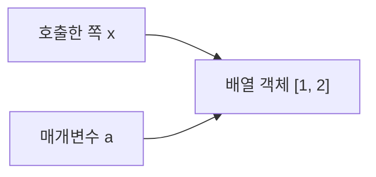
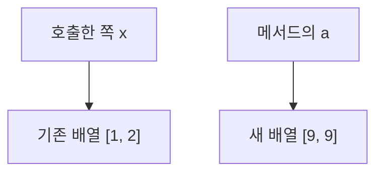

# 프로그래밍 언어: C·Java 기초

[[00-학습-허브]] · [[06-오답-복습]]

## 자료형 선언과 대입

C·Java의 기본 변수 선언에서는 저장할 값의 자료형을 적는다. 문장 끝의 `;`는 세미콜론이다.

| 코드 | 뜻 |
|---|---|
| `int n = 7;` | 정수형 변수 n에 정수 7 저장 |
| `double x = 7.0;` | 실수형 변수 x에 실수 7.0 저장 |

대입은 **오른쪽 식을 먼저 계산한 뒤 그 결과를 왼쪽 변수에 저장**한다. Java에서는 `int n = 3.5;`처럼 실수 값을 정수형 변수에 자동으로 넣으면 컴파일 오류다. 이 규칙은 Java에 대한 설명이다.

## 출력 코드 읽기

- C의 `printf("%d", n);`은 정수 n을 출력한다. `%d`는 정수 출력 형식이다.
- Java의 `System.out.println(n);`은 n을 출력하고 줄을 바꾼다.
- 학습용 짧은 코드에서는 필요한 함수·클래스와 C의 헤더 등을 생략하고, 적절한 실행 위치에 코드가 있다고 가정한다.

## C·Java의 나눗셈과 나머지

```c
int a = 7 / 2;
printf("%d", a); // 3
```

두 피연산자가 정수라서 결과도 정수다. 소수 부분을 버린다. C·Java에서 `7 / 2`는 3이고 `7 / 2.0`은 3.5다. Python의 `7 / 2`는 3.5이므로 구별한다. C·Java의 정수 나눗셈은 음수에서도 0 방향으로 소수 부분을 버리며, Python의 `//`는 내림이라는 차이가 있다. 이번 문제는 양수만 사용한다.

### 계산 후 대입

Java에서 **계산에 쓰인 값의 자료형**과 **결과를 저장할 변수의 자료형**을 따로 확인한다.

| Java 코드 | 오른쪽 식의 결과 | 대입 결과 |
|---|---|---|
| `double r = 7 / 2;` | 정수 나눗셈으로 int 값 3 | double 값 3.0 저장 |
| `double r = 7 / 2.0;` | 실수 나눗셈으로 double 값 3.5 | 3.5 저장 |
| `int n = 3.5;` | double 값 3.5 | 자동 대입 불가, 컴파일 오류 |

첫 줄에서는 오른쪽 계산이 끝난 뒤 정수 3을 double 3.0으로 바꿔 저장한다. 받는 변수가 double이어도 이미 버린 소수 부분이 되살아나지는 않는다. 정수끼리 나눌 때 소수 부분을 버리는 규칙과, Java가 실수를 int 변수에 자동으로 대입할 수 있는지는 별개의 규칙이다. 마지막 줄은 실행 전에 자료형 검사에서 오류가 발생한다.

`%`는 **나머지 연산자**다. 양수 예시로 `7 % 2`는 1이다.

## 명시적 형 변환

C·Java의 숫자 형 변환은 값 앞에 **`(자료형)`**을 붙여 표시할 수 있다. 이번 예시는 Java이며, 양수의 소수 부분을 int로 버리는 경우부터 다룬다.

```java
int n = (int)6.8;
System.out.println(n); // 6
```

`(int)`는 정수로 바꾸겠다고 명시하는 표시다. 이 예시는 Python의 `int(6.8)`과 비슷하며, 반올림해서 7로 만들지 않는다.

**변환 위치에 따라 나눗셈 결과가 달라진다.**

| Java 식 | 계산 과정 | 결과 |
|---|---|---|
| `(double)9 / 2` | 9를 double 9.0으로 바꾼 뒤 나누기 | 4.5 |
| `(double)(9 / 2)` | 괄호 안 정수 나눗셈으로 4를 구한 뒤 double로 변환 | 4.0 |

`(double)`은 자료형 변환 표시이며 `(9 / 2)`는 하나로 묶어 계산할 식이다. 두 종류의 괄호 역할을 구분한다. 계산이 끝난 정수에 double 변환을 해도 버린 소수 부분은 돌아오지 않는다.

## 비교·논리 연산과 조건문

이번 단계는 **Java에서 숫자를 비교하는 경우**다. 비교·논리 식의 결과는 boolean 값인 `true` 또는 `false`이며, Python의 `True`, `False`와 철자가 다르다.

| Java 연산자 | 뜻 | Python의 대응 |
|---|---|---|
| `==`, `!=` | 같은가, 다른가 | `==`, `!=` |
| `>`, `<`, `>=`, `<=` | 크기 비교 | 같은 기호 |
| `&&` | 양쪽 조건이 모두 true인가 | `and` |
| `\|\|` | 한쪽 이상이 true인가 | `or` |
| `!` | true/false 반전 | `not` |

`=`는 대입, `==`는 비교다. 예를 들어 `x = 5`는 값을 저장하고 `x == 5`는 5와 같은지 확인한다. Java 문자열의 `==`는 숫자 비교와 구분해 [[03-프로그래밍-언어#Java 참조 비교]]에서 다룬다.

```java
int score = 80;
if (score >= 60) {
    System.out.println("통과");
} else {
    System.out.println("재시험");
}
```

Java의 `if`는 괄호 안 조건이 `true`이면 첫 블록, `false`이면 `else` 블록을 실행한다. 중괄호 `{ }`가 실행할 코드 묶음을 나타낸다. 이 예시의 출력은 `통과`다.

## for 반복문

Java의 기본 형태는 `for (초기화; 조건; 증감) { 반복할 코드 }`다. **초기화는 한 번** 실행하고, 그다음 **조건 검사 → 본문 → 증감 → 조건 검사**를 반복한다. 조건이 처음부터 false이면 본문을 한 번도 실행하지 않는다.

```java
for (int i = 0; i < 2; i++) {
    System.out.println(i);
}
```

이 예시는 i가 0과 1일 때 실행되어 각각 한 줄씩 출력한다. Python의 `for i in range(2):`와 같은 값 순서로 반복한다고 보면 된다. `i < 2`이므로 2일 때는 실행하지 않는다. `i++`는 i를 1 증가시키고, `sum += i`는 `sum = sum + i`라는 뜻이다.

### 반복문 안의 조건문

`for` 안의 `if`는 반복할 때마다 조건을 검사해 해당 블록을 실행할지 정한다. `if` 조건이 false여도 반복문 자체가 끝나는 것은 아니다. if 블록 뒤의 코드가 있으면 실행하고, for의 증감과 다음 조건 검사로 이어진다.

```java
for (int i = 1; i <= 4; i++) {
    if (i % 2 == 0) {
        System.out.println(i);
    }
}
```

이 예시는 1부터 4까지 반복하되 짝수인 2와 4만 출력한다. 양의 정수에서 `i % 2 == 0`은 짝수, `i % 2 != 0`은 홀수 판정이다. for 블록 밖의 출력은 반복을 마친 뒤 한 번 실행된다. 누적 합계·개수는 각 i에 대해 조건의 참/거짓과 변수 변화를 표로 추적한다.

## while과 반복 제어

Java의 `while (조건) { 본문 }`은 조건을 먼저 검사하고 true인 동안 본문을 반복한다. 처음부터 false이면 0회 실행한다. 반복에 쓰는 변수의 증가는 본문에 작성한 `i++` 같은 문장이 실행될 때 일어난다.

```java
int i = 0;
while (i < 2) {
    System.out.println(i);
    i++;
}
```

이 예시는 0과 1을 각각 한 줄씩 출력한다. Python의 while과 기본 역할이 같다.

| 문장 | 반복문 안에서의 역할 | 다음 실행 위치 |
|---|---|---|
| `break;` | 가장 안쪽 반복문을 즉시 종료 | 그 반복문 밖의 다음 문장 |
| `continue;` | 현재 회차의 남은 본문 생략 | 기본 for에서는 증감식 실행 후 조건 검사, while에서는 조건 검사 |

break로 반복문을 끝내도 반복문 밖의 코드는 이어서 실행한다. continue는 해당 회차에서 뒤에 남은 본문을 건너뛰며, 반복문 전체를 종료하는 것은 아니다. 이번 예시는 레이블 없는 break·continue를 사용한다.

## do-while과 중첩 반복문

Java의 do-while은 **본문 실행 → 조건 검사** 순서다. 정상적으로 본문에 진입하면 조건이 처음부터 false여도 본문을 최소 한 번 실행한다. 조건을 먼저 검사하는 while은 0회 실행될 수 있다. do-while은 마지막 `while (조건);` 뒤의 세미콜론도 문법의 일부다.

```java
int i = 5;
do {
    i++;
} while (i < 3);
System.out.println(i); // 6
```

| 단계 | 실행 | i의 값 |
|---|---|---|
| 초기화 | `i = 5` | 5 |
| 본문 | `i++` | 6 |
| 조건 검사 | `6 < 3`은 false이므로 종료 | 6 |
| 출력 | `System.out.println(i)` | 6 출력 |

`i++`가 독립 문장으로 실행되면 다음 문장에서는 증가된 값을 읽는다. 같은 초기값에서 `while (i < 3) { i++; }`로 작성하면 조건을 먼저 검사하므로 본문을 0회 실행하고 5가 그대로 남는다. do-while의 조건은 **본문 실행 후의 현재 값**으로 검사한다.

do-while은 **본문이 끝날 때마다 조건을 검사**한다. 참이면 다시 본문으로 가고, 거짓이면 반복문 뒤로 이동한다. 조건 검사 자체는 값을 증가시키지 않는다.

`int n=1; do{n+=2;}while(n<5);`를 추적하면 다음과 같다.

| 회차 | 본문 전 n | `n += 2` 실행 후 n | 조건 검사 | 다음 동작 |
|---|---|---|---|---|
| 1 | 1 | 3 | `3 < 5`는 true | 본문으로 돌아감 |
| 2 | 3 | 5 | `5 < 5`는 false | 반복 종료 |

출력은 5다. 조건이 거짓인 5에서 이미 종료하므로 7로 증가시키는 다음 본문은 실행하지 않는다. `<`는 같은 값을 포함하지 않아 `5 < 5`는 거짓이다.

중첩 반복문은 반복문 안에 또 반복문을 넣은 것이다. 바깥 반복이 한 번 실행될 때마다 안쪽 for는 초기화부터 새로 시작한다. 각 반복 횟수가 서로 독립적이고 중간 제어가 없다면 전체 안쪽 본문 실행 횟수는 **바깥 횟수 × 안쪽 횟수**다.

중첩 반복문에서 레이블 없는 `break`는 **가장 안쪽 반복문 하나**를 종료한다. 바깥 반복은 계속된다. 내부 조건이나 break가 있으면 단순히 조건에 적힌 최대 횟수를 곱하지 말고, 실제 본문 실행 횟수를 세어야 한다.

## Java 배열 기초

배열은 같은 자료형의 값을 여러 개 묶어 저장한다. `int[] a = {4, 8, 12};`는 int 값 3개를 가진 배열이다. 대괄호 안의 **인덱스는 0부터** 시작한다.

| 인덱스 | 0 | 1 | 2 |
|---|---|---|---|
| 값 | 4 | 8 | 12 |

- `a[1]`은 인덱스 1의 값인 8이다. 인덱스와 저장된 값을 구분한다.
- `a.length`는 원소 개수 3이며 괄호를 붙이지 않는다. Python의 `len(a)`에 대응한다.
- 마지막 유효 인덱스는 `a.length - 1`이다. 이 예시의 마지막 원소는 `a[2]`다.
- Java 배열은 생성한 뒤 길이가 고정된다. Python list처럼 길이가 늘어나지는 않는다.
- Java에서 `a[-1]`은 마지막 원소가 아니다. 음수나 길이 이상의 인덱스에 접근하면 실행 중 범위 초과 예외가 발생한다. 문법이 맞아 컴파일되어도 실행이 정상 완료된다는 뜻은 아니다.

```java
int sum = 0;
for (int i = 0; i < a.length; i++) {
    sum += a[i];
}
System.out.println(sum); // 24
```

배열 전체를 인덱스로 순회할 때 조건은 보통 `i < a.length`다. `i <= a.length`로 쓰면 길이와 같은 인덱스까지 접근해 범위를 벗어난다. 이는 Java의 설명이며 C의 배열 범위 초과 동작과 구분한다.

### 배열 경계와 실행 중 오류

```java
int[] a = {5, 10, 15};
for (int i = 0; i <= a.length; i++) {
    System.out.println(a[i]);
}
```

| i | `i <= 3` | 접근과 결과 |
|---|---|---|
| 0 | true | `a[0]`의 5 출력 |
| 1 | true | `a[1]`의 10 출력 |
| 2 | true | `a[2]`의 15 출력 |
| 3 | true | `a[3]`은 존재하지 않아 범위 초과 예외 발생 |

이 코드는 컴파일되지만 실행이 정상 완료되지는 않는다. **5·10·15를 출력한 뒤** `ArrayIndexOutOfBoundsException`이 발생한다. 앞서 출력한 값은 그대로 남는다. 예외 처리 코드가 없는 이 예시에서는 그 뒤의 문장도 실행하지 않는다.

올바른 전체 순회 조건은 `i < a.length`, 마지막 원소 접근은 `a[a.length - 1]`이다. 길이 3과 마지막 인덱스 2를 구분한다.

### 배열 원소 변경

배열의 각 원소도 대입으로 바꿀 수 있다. 오른쪽 식을 현재 값으로 먼저 계산하고, 그 결과를 왼쪽 인덱스의 칸에 저장한다.

```java
int[] a = {4, 8, 12};
a[1] = 10;
a[2] += 3;
```

실행 뒤 배열은 `{4, 10, 15}`다. `a[2] += 3`은 이 정수 예시에서 `a[2] = a[2] + 3`과 같은 결과이며, `a[i] *= 2`는 해당 원소를 2배로 바꾼다. 인덱스 i 자체를 바꾸는 것과 그 칸에 저장된 값 `a[i]`를 바꾸는 것을 구분한다.

반복문에서 앞쪽 원소를 바꿨다면 뒤의 계산은 **이미 변경된 현재 값**을 읽는다. `a[i] += a[i - 1]`처럼 앞 원소를 이용하는 코드는 매 반복 뒤 배열 상태를 적어 추적한다. 배열 원소를 바꿔도 배열의 길이는 그대로다.

`{1, 2, 3, 4}`를 i=1부터 끝까지 `a[i] += a[i - 1]`로 갱신하면 다음과 같다.

| i | 계산 | 갱신 후 배열 |
|---|---|---|
| 1 | `2 + 1 = 3` | `{1, 3, 3, 4}` |
| 2 | `3 + 3 = 6` | `{1, 3, 6, 4}` |
| 3 | `4 + 6 = 10` | `{1, 3, 6, 10}` |

## Java 메서드 호출과 반환값

메서드는 이름을 붙인 코드 묶음이다. 입력을 받아 계산하고 결과를 반환할 수 있으며, Python의 함수와 비교해 이해할 수 있다.

```java
static int add(int a, int b) {
    return a + b;
}
```

| 부분 | 의미 |
|---|---|
| 메서드 이름 앞의 `int` | 반환하는 값의 자료형 |
| `add` | 메서드 이름 |
| `int a, int b` | 입력을 받을 매개변수와 각각의 자료형 |
| `return a + b;` | 현재 메서드 호출을 끝내고 계산 결과를 호출한 곳으로 반환 |

메서드 정의는 클래스 안에 두고, 다음 실행 코드는 같은 클래스의 main 안에 있다고 가정한다. 이번 예시는 main에서 객체를 만들지 않고 호출할 수 있도록 static 메서드를 사용한다.

```java
int result = add(2, 3);
System.out.println(result); // 5
```

`add(2,3)`의 2·3은 인수이며, 각각 매개변수 a·b에 전달된다. 반환값 5가 호출식 `add(2,3)`의 결과가 되어 result에 저장된다. return 자체는 화면에 출력하지 않는다. 출력은 println이 실행할 때 일어난다.

이번에 다루는 **int 인수는 값이 복사되어 전달**된다. 메서드 안에서 매개변수를 바꿔도 호출한 쪽의 int 변수 자체는 바뀌지 않는다. 호출할 때마다 매개변수를 새로 받아 실행하며, if 안에서 return을 만나도 해당 메서드 호출은 그 자리에서 끝난다.

### 배열 인수와 참조값의 복사

**Java의 인수 전달은 항상 값 전달이다.** 배열 변수에는 어떤 배열 객체를 가리키는지 나타내는 참조값이 들어 있다. 배열을 메서드에 전달할 때는 이 참조값을 복사하므로, 호출한 쪽 변수 x와 매개변수 a가 같은 배열 객체를 가리킨다.



| 메서드 안의 코드 | 바뀌는 대상 | 호출한 쪽에서의 결과 |
|---|---|---|
| `a[0] = 9;` | 같은 배열 객체의 첫 원소 | x로 읽어도 첫 원소가 9 |
| `a = new int[]{9, 9};` | 지역 매개변수 a가 가리키는 배열 | x는 기존 배열을 계속 가리킴 |

`a = new int[]{9,9};` 실행 직후, 메서드 안에서의 연결은 다음과 같다. 호출한 쪽 x의 참조값은 대입 대상에 포함되지 않는다.



메서드가 끝난 뒤 `x[0]`을 읽으면 기존 배열의 첫 값 1이다. `a[0]`은 현재 가리키는 배열의 원소이고, `a`는 참조값을 저장하는 지역 매개변수라는 차이를 확인한다. 여러 문장이 있으면 각 줄에서 a가 어느 배열을 가리키는지 먼저 확인한다.

`new int[]{9,9}`는 9·9를 담은 새 배열을 만든다. 배열 원소 변경과 매개변수에 새 참조값을 대입하는 것을 구분한다. Python에서도 리스트 원소를 바꾸는 경우와 지역 매개변수에 새 리스트를 대입하는 경우를 비교하면 이해에 도움이 된다.

`static void change(int[] a)`에서 `int[]`는 배열 매개변수의 자료형이고 **void는 반환값이 없다는 뜻**이다. 반환값이 없어도 같은 배열의 원소를 바꿀 수 있다. 배열을 전달하는 것을 단순히 참조 전달이라고 부르지 말고, **참조값을 복사해 전달한다**고 표현한다.

원소 변경 후 참조값을 재대입하는 순서도 각각 추적한다. x와 a가 처음에 `{1,2}`를 가리킬 때 다음과 같다.

| 실행한 문장 | x가 가리키는 배열 | a가 가리키는 배열 |
|---|---|---|
| `a[0]=7;` | `{7,2}` | x와 같은 `{7,2}` |
| `a=new int[]{9,9};` | `{7,2}` | 새 배열 `{9,9}` |
| `a[1]=8;` | `{7,2}` | 새 배열의 내용이 `{9,8}`로 변경 |

메서드가 끝난 뒤 `x[0]+x[1]`은 9다. `a[0]=7`은 **기존 원소에 대한 대입**, `a=new int[]{9,9}`는 **새 배열 생성 후 기존 매개변수에 참조값 재대입**이다. 둘 다 새 변수를 선언하는 문장은 아니다.

## C의 주소와 포인터

포인터는 주소를 저장하는 변수다. 이번 예시는 유효한 int 변수의 주소를 int 포인터에 저장하고, 그 변수가 살아 있는 main 안에서 사용한다.

```c
int x = 5;
int *p = &x;
*p = 9;
printf("%d", x); // 9
```

| 표현 | 의미 |
|---|---|
| `&x` | x의 주소 |
| `int *p = &x;` | int 변수를 가리키는 포인터 p를 선언하고 x의 주소로 초기화 |
| `p` | 저장된 주소 값 |
| `*p` | p가 가리키는 변수에 접근하는 역참조 |
| `*p = 9;` | p가 가리키는 변수에 9를 대입 |

선언에서 `int *p`의 별표는 포인터 선언 표시이고, 실행 식의 `*p`는 역참조다. `int y=x`는 x의 값을 y에 복사한다. `p=&y`는 p가 y를 가리키게 바꾸며, 그다음 `*p`로 대입하면 y가 바뀐다. 포인터에 주소를 대입하는 것과 가리키는 변수의 값을 바꾸는 것을 구분한다.

코드 문제는 `<stdio.h>`를 포함하고 main 내부에서 실행한다고 가정한다. `%d`는 int 출력 형식이다.

### 값 복사와 포인터 대상 변경

`int y = x;`는 x의 현재 값을 별개의 int 변수 y에 복사한다. 이후 y에 대입하면 y만 바뀐다.

| 실행한 문장 | x | y |
|---|---|---|
| `int x=3; int y=x;` | 3 | 3 |
| `y=8;` | 3 | 8 |

따라서 x를 출력하면 3이다. 포인터는 저장된 주소를 바꿀 수 있다. `p=&y`를 실행한 뒤의 `*p`는 현재 가리키는 y에 접근한다.

| 실행한 문장 | p가 가리키는 변수 | x | y |
|---|---|---|---|
| `int x=2; int y=5; int *p=&x;` | x | 2 | 5 |
| `p=&y;` | y | 2 | 5 |
| `*p=9;` | y | 2 | 9 |

출력은 `2 9`다. 포인터를 처음 선언할 때 가리킨 변수와, 뒤의 대입 시점에 현재 가리키는 변수를 구분한다. `*p`를 읽거나 쓸 때마다 p에 저장된 현재 주소를 확인한다.

`a=4`, `b=6`에서 `p=&b`를 실행했다면, 그 시점의 `*p=*p+1`은 **`b=b+1`로 읽을 수 있다**. 오른쪽에서 b의 값 6을 읽어 7을 계산하고, 왼쪽에서도 같은 b에 저장한다. a는 4로 남아 출력은 `4 7`이다. 계산 전에 현재 대상 변수를 먼저 정하고 양쪽 `*p`를 그 변수로 풀어 읽는다.

## C 함수의 값·포인터 인수와 반환값

**C 함수도 인수의 값을 복사해 받는다.** 함수의 매개변수는 호출한 쪽 변수와 별개의 변수다. 포인터를 인수로 넘길 때도 주소값을 복사하며, 복사한 주소로 원래 변수에 접근할 수 있다.

```c
void set_value(int n) {
    n = 9;
}

void set_at(int *p) {
    *p = 9;
}
```

| 호출 형태 | 매개변수가 받는 값 | 함수 안에서 대입할 때 |
|---|---|---|
| `set_value(x)` | x의 정수 값 복사 | `n=9`는 n만 변경 |
| `set_at(&x)` | x의 주소값 복사 | `*p=9`는 그 주소의 x를 변경 |

`void`는 반환값이 없다는 뜻이며, 반환값이 없어도 포인터로 호출한 쪽 변수를 바꿀 수 있다. `int` 반환형의 함수는 return으로 정수 결과를 돌려준다. `x = f(x);`는 함수가 돌려준 결과를 호출한 쪽에서 x에 다시 대입하는 흐름이다.

이번 함수 정의는 main 앞에 있고 `<stdio.h>`를 포함한다고 가정한다. 이름이 같은 함수가 여러 문제에 나오더라도 각 문제는 독립적으로 실행한다.

### 포인터 인수로 값 교환하기

두 변수의 값을 교환할 때는 원래 한쪽 값을 임시 변수에 보관한다. x=4·y=9의 예시는 다음과 같다.

| 문장 | t | x | y |
|---|---|---|---|
| `int t=x;` | 4 | 4 | 9 |
| `x=y;` | 4 | 9 | 9 |
| `y=t;` | 4 | 9 | 4 |

일반 int 매개변수 a·b를 교환하면 함수 안의 복사본만 바뀐다. int 포인터 a·b로 받은 주소를 통해 `*a`, `*b`에 대입하면 호출한 쪽 변수의 값을 교환할 수 있다. `int t=*a`로 원래 값을 보관한 뒤 `*a=*b; *b=t;` 순서로 실행한다.

`swap(int a, int b)`를 x=2·y=7로 호출한 경우, 함수의 매개변수와 호출한 쪽 변수는 다음처럼 구분한다.

| 시점 | swap 안의 a·b | main의 x·y |
|---|---|---|
| 호출 직후 | 2·7 | 2·7 |
| 함수 안에서 교환한 뒤 | 7·2 | 2·7 |

함수 안의 교환은 실제로 실행된다. 이때 바뀌는 변수는 매개변수 a·b다. 호출한 쪽의 `printf("%d %d",x,y)`는 main의 x·y를 읽어 `2 7`을 출력한다. 출력문이 어느 함수에 있고 어떤 변수를 읽는지 확인한다.

`p=q`는 **q에 저장된 주소값을 p에 복사**한다. 따라서 이후 p와 q는 같은 변수를 가리키지만 포인터 매개변수 p·q 자체는 별개다. 함수 안에서 p가 가리키는 대상을 바꾼 뒤 `*p`에 대입하면, 그 시점에 p가 가리키는 변수의 값이 바뀐다.

## C 배열과 포인터 연산

```c
int a[] = {4, 8, 12};
int *p = a;
```

이 초기화에서 배열 식 a는 첫 원소의 주소로 변환되므로, p는 `&a[0]`으로 초기화한 것과 같이 첫 원소를 가리킨다. 배열 자체와 포인터 변수는 구분한다.

**p와 `*p`는 서로 다른 종류의 값이다.** 예를 들어 `int a[]={5,8}; int *p=a;`라면 p에는 첫 원소의 주소 `&a[0]`이 저장되고, `*p`는 그 주소에 있는 정수 5를 읽는다. `p=p+1`을 실행하면 p에는 다음 int 원소의 주소 `&a[1]`이 저장되며, 이때 `*p`는 정수 8이다. 포인터에 1을 더하면 다음 int 원소로 이동한다. 원소의 값 5에 1을 더하는 계산과 구분한다.

`printf("%d", *p)`는 `*p`가 정수이므로 원소의 값을 출력한다. 주소를 출력하려면 `printf("%p", (void *)p)`를 사용한다. `printf("%d", p)`처럼 포인터를 정수 출력 형식에 전달하는 코드는 형식이 맞지 않는다.

p가 처음처럼 첫 원소를 가리킬 때의 관계는 다음과 같다.

| 원소 | 주소를 나타내는 식 | 값을 읽는 식 | 값 |
|---|---|---|---|
| `a[0]` | `p` | `*p` | 4 |
| `a[1]` | `p+1` | `*(p+1)` | 8 |
| `a[2]` | `p+2` | `*(p+2)` | 12 |

int 포인터의 `p+1`은 다음 int 원소의 주소다. `p=p+1`을 실행하면 p가 다음 원소를 가리키게 되고, 배열 원소의 값은 그대로다. 이후 `*p`에 대입하면 현재 가리키는 원소의 값이 바뀐다.

값을 읽거나 쓰기 전에 p가 현재 어느 원소를 가리키는지 확인한다. 이번 문제는 배열의 유효한 원소 범위 안에서만 접근한다.

### 원소 값 연산과 주소 연산 구분

`int a[]={3,5,7}; int *p=a;`에서 p는 `a[0]`을 가리킨다.

| 표현식 | 계산 과정 | 결과 |
|---|---|---|
| `*p+1` | 현재 원소의 값 3에 1을 더함 | 4 |
| `*(p+1)` | 다음 원소 `a[1]`의 주소로 접근해 값을 읽음 | 5 |

`*p+1`은 `(*p)+1`로 해석한다. 두 표현식 모두 계산만 하며 p나 배열 원소를 바꾸지 않는다. `p=p+1`처럼 p에 다시 대입하면 가리키는 원소가 바뀌고, `*p=*p+1`처럼 역참조한 곳에 대입하면 그 원소의 값이 바뀐다.

다음 두 문장이 이어질 때는 배열 값과 p의 위치를 따로 추적한다.

| 실행 직후 | 배열 `a` | p가 가리키는 원소 |
|---|---|---|
| `int a[]={2,4,6}; int *p=a;` | `{2,4,6}` | `a[0]` |
| `*p=*p+1;` | `{3,4,6}` | `a[0]` |
| `p=p+1;` | `{3,4,6}` | `a[1]` |

마지막에 `a[0]`과 `*p`를 읽으면 각각 3과 4다. 포인터를 옮기는 문장은 배열의 값을 증가시키지 않는다.

반대로 `int a[]={5,8}; int *p=a;`에서 먼저 `p=p+1`을 실행하면 p는 `a[1]`을 가리키고 배열은 `{5,8}` 그대로다. 그다음 `*p=*p+1`은 `a[1]=a[1]+1`이므로 배열은 `{5,9}`가 된다. **대입문을 실행할 때마다 현재 p가 가리키는 원소를 확인한다.**

### C 배열 경계와 끝 다음 위치

`int a[]={5,8};`의 원소는 `a[0]`과 `a[1]` 두 개다. `a+2`는 배열의 **마지막 원소 바로 다음 위치를 나타내는 포인터**로 만들 수 있지만, 그 위치에는 읽을 배열 원소가 없다. 따라서 `int *p=a+2;`까지는 가능하고, 이어서 `*p`를 읽으면 **정의되지 않은 동작**이다. 출력값이나 실행 중 오류 발생 여부를 보장할 수 없다.

C에서 `a[2]`로 읽는 것은 `*(a+2)`로 읽는 것과 같아서 역시 정의되지 않은 동작이다. 우연히 숫자가 출력되거나 프로그램이 종료되는 등 관찰 결과가 달라질 수 있지만, C는 어느 한 결과를 보장하지 않는다. Java의 길이 2 배열에서 `a[2]`를 읽으면 실행 중 `ArrayIndexOutOfBoundsException`이 발생한다. C에서는 포인터가 가리키는 원소가 배열 범위 안인지 먼저 확인한다.

참고: [ISO C11 초안 §6.5.2.1·§6.5.6 (WG14 N1570)](https://www.open-std.org/jtc1/sc22/wg14/www/docs/n1570.pdf) · [Java 언어 명세 §10](https://docs.oracle.com/javase/specs/jls/se26/html/jls-10.html), 2026-10-28 확인.

## C 문자열의 널 종료와 길이

`sizeof`는 대상이 차지하는 **메모리 크기를 바이트 단위로 구하는 C 연산자**다. 이 예시처럼 배열 변수 `s`에 직접 사용하면 배열 전체의 저장 공간을 구한다.

`char s[] = "cat";`은 문자 3개와 끝을 알리는 널 문자 `'\0'`까지 저장한다. `'\0'`은 숫자 문자 `'0'`과 다르다.

| 인덱스 | 0 | 1 | 2 | 3 |
|---|---|---|---|---|
| 저장 값 | `'c'` | `'a'` | `'t'` | `'\0'` |

`char` 한 칸은 1바이트이므로 `sizeof(s)`는 **4바이트**다. `<string.h>`의 `strlen(s)`는 **첫 널 문자 앞의 `char` 원소 수**인 3을 반환한다. 둘 다 결과형이 `size_t`이므로 C99 이상에서 `printf`로 출력할 때는 `%zu`를 사용한다. `strlen`이 언제나 `sizeof - 1`인 것은 아니므로 두 연산의 의미를 구분한다.

배열 크기를 직접 정하면 차이가 더 커질 수 있다. `char t[8]="go";`에서는 배열이 8바이트이므로 `sizeof(t)`는 8이고, 널 문자 앞의 길이인 `strlen(t)`는 2다.

참고: [ISO C11 초안 §6.7.9·§6.5.3.4·§7.24.6.3 (WG14 N1570)](https://www.open-std.org/jtc1/sc22/wg14/www/docs/n1570.pdf), 2026-10-28 확인.

## C 문자열 내용 비교

`<string.h>`의 `strcmp(a,b)`는 두 널 종료 문자열의 **내용을 비교**한다. 내용이 같으면 **정확히 0**을 반환한다. 다르면 처음 다른 문자를 기준으로 왼쪽이 앞서면 음수, 뒤서면 양수를 반환한다. 음수·양수의 정확한 크기(`-1`, `1` 등)는 보장되지 않으므로 같음은 `==0`, 다름은 `!=0`으로 검사한다. 크기나 주소가 같다는 사실만으로 문자열 내용이 같다고 판정할 수 없다.

`char a[]="cat"; char b[]="cat";`은 별개 배열이다. `strcmp(a,b)==0`은 참이고, `a==b`는 배열의 첫 원소 주소를 비교하므로 거짓이다. Java에서 내용 비교에 `String.equals()`를 쓰는 것과 연결해 기억한다. [[03-프로그래밍-언어#Java 참조 비교]]

참고: [ISO C11 초안 §7.24.4.2 (WG14 N1570)](https://www.open-std.org/jtc1/sc22/wg14/www/docs/n1570.pdf), 2026-10-28 확인.

## C의 전위·후위 증감

| 코드 | 먼저 일어나는 일 | 최종 값 | 출력 |
|---|---|---|---|
| `int a=3; int b=a++;` | 기존 `a=3`을 `b`에 넣고 `a` 증가 | `a=4, b=3` | `4 3` |
| `int a=3; int b=++a;` | `a` 증가 후 `b`에 넣기 | `a=4, b=4` | `4 4` |
| `int x=5; int y=x--;` | 기존 `x=5`를 `y`에 넣고 `x` 감소 | `x=4, y=5` | `4 5` |

`a++`는 **현재 값 사용 후 증가**, `++a`는 **증가 후 값 사용**이다. 후위 감소 `x--`도 같은 순서로 생각한다.

## Java 참조 비교

참조형 변수에서 `==`는 **같은 객체를 가리키는지**, `String.equals()`는 **문자열 내용이 같은지** 비교한다.

```java
String a = new String("hi");
String b = new String("hi");
System.out.println(a == b);      // false: 서로 다른 객체
System.out.println(a.equals(b)); // true: 내용은 같음

String c = a;
System.out.println(a == c);      // true: 새 객체 없이 같은 객체를 참조
```

Python에 익숙하다면 이 상황의 Java `a == b`는 Python의 `a is b`처럼 **동일 객체 여부**를 묻는다고 생각할 수 있다. 다만 Python의 `==`와 Java의 `==`는 언어 전체에서 의미가 같지 않으므로 이 비유는 참조 비교에만 사용한다.

## Java 상속과 메서드 오버라이딩

`class Dog extends Animal`은 Dog가 Animal을 상속한다는 뜻이다. 자식 클래스가 부모의 인스턴스 메서드를 같은 이름·매개변수로 다시 정의하면 **오버라이딩**이다. `@Override`는 그 의도를 표시하고 컴파일러가 재정의 가능 여부를 검사하게 한다.

`Animal a = new Dog();`처럼 부모 타입 변수로 자식 객체를 참조할 수 있다. `a.sound()`처럼 오버라이딩된 인스턴스 메서드를 호출하면 변수의 선언 타입이 아니라 **실제 객체의 클래스**에 맞는 구현이 실행된다. Animal의 `sound()`가 `"animal"`, Dog의 재정의 메서드가 `"dog"`를 반환하면 `a.sound()`의 결과는 `"dog"`다. Python의 하위 클래스에서 메서드를 다시 정의하는 경우와 비슷하다.

Animal에 `String describe() { return "sound=" + sound(); }`가 있고 Dog 객체에서 `describe()`를 호출해도, 그 안의 `sound()`는 실제 Dog 객체의 재정의 메서드로 연결된다. 따라서 결과는 `"sound=dog"`다.

자식 클래스의 메서드 안에서 `super.sound()`라고 쓰면 부모 클래스의 `sound()` 구현을 명시적으로 호출한다. Dog의 `sound()`가 `super.sound() + "-dog"`를 반환한다면, `Animal a = new Dog(); a.sound()`는 Dog의 메서드에 들어간 뒤 부모의 `"animal"`을 가져와 `"animal-dog"`가 된다.

## Java 필드 숨김과 메서드 오버라이딩

부모와 자식 클래스에 같은 이름의 **필드**를 각각 선언하면 자식 필드가 부모 필드를 **숨긴다**. `Animal a = new Dog();`에서 `a.name`처럼 필드에 접근할 때는 참조 변수 `a`의 **선언 타입 Animal**에 있는 필드를 선택한다. 오버라이딩된 인스턴스 **메서드** `a.sound()`는 실제 객체 Dog의 구현을 선택한다. 필드와 메서드의 선택 기준을 구분한다.

Animal과 Dog에 각각 `name` 필드가 있고 `Dog d = new Dog(); Animal a = d;`라고 하면, `a`와 `d`는 **같은 Dog 객체**를 가리키지만 선언 타입이 다르다.

| 표현식 | 선택 기준 | 결과 예시 |
|---|---|---|
| `a.name` | 선언 타입 Animal의 필드 | `"animal"` |
| `d.name` | 선언 타입 Dog의 필드 | `"dog"` |
| `a.sound()` | 실제 객체 Dog의 재정의 메서드 | `"dog"` |

**같은 객체를 가리킨다는 사실과 어떤 필드를 읽는지는 별개다.** Dog 객체 안에는 `Animal.name`과 `Dog.name`이라는 서로 다른 두 필드가 있다. `Animal a = d;`는 객체를 새로 만들지 않고 참조값을 복사하지만, 표현식 `a.name`은 선언 타입 Animal의 필드를 읽는다.

숫자로 바꾼 예에서도 규칙은 같다. Parent의 필드 `count=10`과 메서드 `value()=100`, Child의 필드 `count=20`과 재정의 메서드 `value()=200`이 있을 때 `Parent x = new Child();`라면 `x.count`는 **10**, `x.value()`는 **200**이다. 필드와 메서드를 각각 따로 결정한 뒤 출력을 합친다.

**반환값의 유무는 선택 기준이 아니다.** `x.value()`를 컴파일할 때는 변수 타입 Parent에서 호출 가능한 메서드인지 확인하고, 실행할 때는 실제 Child 객체의 재정의된 `value()` 본문을 선택한다. 따라서 Child 본문이 실행된 결과로 200이 반환된다. 반환값이 없는 `void show()`도 Child에서 재정의했다면 `x.show()`는 Child 본문을 실행한다. 반대로 Child가 메서드를 재정의하지 않았다면 상속받은 Parent 본문이 실행된다.

참고: [Java 언어 명세 §15.11.1·§15.12 (Oracle)](https://docs.oracle.com/javase/specs/jls/se26/html/jls-15.html), 2026-10-28 확인.

## Java 메서드 오버로딩

**오버로딩**은 같은 이름의 메서드를 **매개변수의 개수나 타입을 다르게** 정의하는 것이다. `show(int x)`와 `show(String x)`는 한 클래스에 함께 둘 수 있다. `show(3)`은 `int` 버전, `show("3")`은 `String` 버전을 호출한다. 컴파일러가 호출에 전달된 인수의 개수·타입을 보고 적합한 메서드를 고른다. 반환 타입만 다르게 하는 것으로는 오버로딩할 수 없다.

입문 단계에서 **메서드 시그니처**는 메서드 이름과 매개변수 타입 목록(개수·순서)으로 구분한다. `sum(int a, int b)`와 `sum(int x, int y)`는 매개변수 이름만 다르므로 같은 시그니처다. `sum(int a)`는 매개변수 개수가 달라 오버로딩할 수 있다. 반환 타입이나 접근 제어자만 바꾼 같은 시그니처의 메서드를 한 클래스에 중복 선언할 수 없다.

문제를 풀 때는 매개변수 **이름을 지우고 타입만 적어** 비교한다. `sum(int a, int b)`와 `sum(int x, int y)`는 둘 다 `sum(int, int)`이므로 중복 선언이고, `sum(int a)`는 `sum(int)`이어서 별도 메서드가 된다.

앞에서 배운 **오버라이딩**은 자식 클래스가 상속받은 인스턴스 메서드를 같은 매개변수로 재정의하여, 실제 객체에 따라 실행할 본문이 달라지는 것이다. 오버로딩은 **호출 인수에 맞는 메서드 선택**, 오버라이딩은 **재정의된 메서드 본문 선택**으로 구분한다.

두 규칙이 한 코드에 있으면 순서대로 판단한다. 먼저 변수의 선언 타입에서 호출 가능한 메서드 중 전달한 인수의 타입·개수에 맞는 `print(int)` 또는 `print(String)`처럼 **어느 시그니처를 호출하는지** 정한다. 그다음 선택된 인스턴스 메서드를 실제 객체의 클래스가 재정의했는지 보고 **어느 본문을 실행하는지** 정한다.

## Java 생성자와 객체 초기화

`new Box(7)`처럼 객체를 만들면 클래스 이름과 같은 **생성자** `Box(int v)`가 호출된다. 생성자는 반환 타입을 적지 않으며, 전달된 값으로 새 객체의 필드를 초기화할 수 있다. 예를 들어 `Box(int v) { value = v; }`라면 인수 7이 매개변수 v에 들어가고, 그 객체의 `value` 필드가 7이 된다. `int` 인스턴스 필드의 기본값은 0이지만 생성자에서 대입했다면 이후 읽는 값은 대입한 값이다. Python의 `__init__`처럼 새 객체의 초기 상태를 설정한다고 생각할 수 있다.

매개변수와 필드의 이름이 모두 `value`라면 이름만 쓴 `value`는 가까운 **매개변수**를 가리킨다. 같은 이름을 쓰는 것은 컴파일 오류가 아니다. `this`는 지금 생성 중인 객체를 가리키므로 `this.value`는 **그 객체의 필드**다. `this.value = value;`는 매개변수를 필드에 저장하지만, `value = value;`는 매개변수를 자기 자신에게 대입해 필드를 바꾸지 않는다. 필드 초기값이 1이고 인수가 7이라면 뒤의 문장만 실행한 후에도 필드는 1이다.

`Box()`와 `Box(int value)`처럼 **매개변수 구성이 다른 생성자**를 한 클래스에 함께 정의할 수 있다. 이를 생성자 오버로딩이라고 한다. `new Box()`와 `new Box(5)`는 각각 인수에 맞는 생성자를 호출한다. 두 번의 `new`로 만들어진 객체는 별개이므로 각 객체의 인스턴스 필드값도 따로 저장된다.

## Java static 필드와 인스턴스 필드

`static int count`처럼 `static`이 붙은 필드는 **클래스에 속하며 모든 객체가 공유**한다. `int value`처럼 `static`이 없는 인스턴스 필드는 **객체마다 따로** 있다. 공유 필드는 `Box.count`처럼 클래스 이름으로 접근할 수 있다.

생성자에서 `count++`를 실행한다면 객체를 두 번 만들 때 공유 필드 `Box.count`는 2가 된다. 같은 두 객체를 `new Box(2)`, `new Box(5)`로 만들면서 `this.value = value`를 실행했다면 각 객체의 `value`는 각각 2와 5다. 공유 필드와 객체별 필드를 따로 추적한다.

인스턴스 메서드 `a.add()`에서 `count++`와 `value++`를 함께 실행하면 공유 `count`와 **호출 대상 a의** `value`가 각각 증가한다. `a.add()`를 두 번, `b.add()`를 한 번 실행한 뒤에는 `Box.count=3`, `a.value=2`, `b.value=1`이다.

## Java static 메서드

`static`은 메서드에도 붙일 수 있다. `static` 메서드는 `Box.read()`처럼 클래스 이름으로 호출할 수 있다.

`static` 메서드에는 호출 대상 객체를 뜻하는 `this`가 없다. 따라서 `int value = 5;`처럼 객체별로 존재하는 인스턴스 필드를 `static int read() { return value; }`에서 **이름만으로 직접 읽으면 컴파일 오류**다. 특정 객체를 만든 뒤 `b.value`처럼 그 객체를 명시하면 `static` 메서드 안에서도 읽을 수 있다. `static` 필드는 클래스에 속하므로 정적 메서드에서 직접 접근할 수 있다.

`static int read()`의 `int`는 **반환값의 자료형**이고, 이 선언은 `value` 변수를 만들지 않는다. `Box b = new Box();`의 지역 변수는 객체를 가리키는 `b`이며, `b.value`는 그 객체의 인스턴스 필드다. 실제로 `Box b = new Box(); return b.value;`라고 쓰면 정적 메서드에서도 새 객체의 필드값 5를 반환할 수 있다. 메서드 안에 별도의 지역 변수 `value`를 만들려면 `int value = 7;`처럼 직접 선언해야 한다.

클래스에 `int value = 5;`라는 인스턴스 필드가 있어도 `static int read() { int value = 7; return value; }`는 컴파일된다. `read()` 안의 `int value = 7;`은 **지역 변수 선언**이고, 이름만 쓴 `return value;`는 가까운 지역 변수 7을 읽는다. 필드 5는 바뀌지 않는다. 객체를 가리키는 `this`는 인스턴스 메서드에서 필드를 명시할 때 쓸 수 있다.

인스턴스 메서드에서 `int value = 7; return value + this.value;`를 실행하면 `value`는 지역 변수 7, `this.value`는 객체의 필드 5이므로 결과는 12다.

## Java 예외 처리 기본 흐름

`try`에는 실행할 코드를 넣는다. 실행 중 예외가 발생하면 그 지점 이후의 `try` 문장은 건너뛰고 해당 예외를 처리하는 `catch`로 이동한다. 이 코드처럼 `finally`가 있으면 `catch` 처리 후에도 `finally`의 문장을 실행한다. 배열 범위 밖 접근에서 발생하는 `ArrayIndexOutOfBoundsException`을 예로 들 수 있다.

`int[] a={4,7};`의 유효한 인덱스는 0과 1이다. `try`의 첫 문장이 `System.out.print(a[2]);`이면 출력 인수를 평가하다 예외가 나므로 숫자도, 뒤따르는 `"A"`도 출력되지 않는다. `catch`가 `"B"`, `finally`가 `"C"`를 출력하면 결과는 `BC`다.

반대로 `a[1]`은 유효하므로 `try`에서 `7`과 `A`를 출력하고 `catch`는 건너뛴다. `finally`의 `C`는 실행되어 결과는 `7AC`다. 예외 발생 여부에 따라 `catch` 실행 여부를 판단하고 `finally`를 확인한다.

예외가 발생하기 **전**에 실행한 출력은 남는다. 예를 들어 `A`를 출력한 다음 `a[2]`에서 예외가 나면 그 뒤의 `B`는 건너뛰지만, 앞의 `A`는 사라지지 않는다. `catch`가 `C`, `finally`가 `D`를 출력하고 `try`·`catch`·`finally` 뒤의 문장이 `E`를 출력하면 결과는 `ACDE`다.

여러 `catch`가 있으면 발생한 예외와 맞는 처리 블록으로 이동한다. `a[2]`에서 생긴 예외는 `ArrayIndexOutOfBoundsException`이므로 `ArithmeticException`을 처리하는 블록은 실행하지 않는다. 앞에서 `A`를 출력하고, 맞는 `catch`에서 `D`, `finally`에서 `E`를 출력하는 예제의 결과는 `ADE`다.

## Java switch와 break

`switch (n)`은 `n`과 일치하는 `case`부터 실행한다. `case` 라벨 자체는 실행을 멈추지 않는다. `break`가 없으면 다음 `case`의 문장도 이어서 실행하고, `break`를 만나면 `switch`를 빠져나간다.

예를 들어 `n=2`에서 `case 2`가 `B`를 출력하고 `break` 없이 `case 3`으로 이어져 `C`를 출력한 뒤 `break`를 만나면 결과는 `BC`다. 이때 `case 3`의 값이 2와 일치하지 않아도 이미 진입한 실행 흐름은 계속된다. `default`의 출력은 실행되지 않는다.

`n=1`에서 `case 1`이 `A`를 출력하고 `break`가 없어 `case 2`의 `B`까지 출력한 뒤 `break`를 만나면 `switch`가 끝난다. 그 뒤에 있는 일반 문장이 `D`를 출력한다면 전체 결과는 `ABD`다. `break`는 해당 `switch`를 벗어날 뿐, 바깥의 다음 문장까지 건너뛰지는 않는다.
