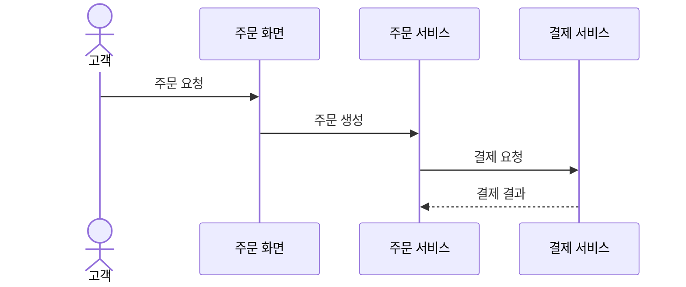

# 소프트웨어 설계

[[00-학습-허브]] · [[04-테스트와-보안]] · [[07-학습-진도]]

## 기능 요구사항과 비기능 요구사항

| 구분 | 묻는 내용 | 온라인 쇼핑몰의 예 |
|---|---|---|
| **기능 요구사항** | 시스템이 **무엇을 하는가?** | 회원 로그인, 주문 취소, 주문 내역 조회 |
| **비기능 요구사항** | 그 기능을 **어떤 품질이나 조건으로 제공하는가?** | 검색 결과를 2초 이내에 표시 |

`검색 결과를 표시한다`는 제공할 기능을 말하고, `2초 이내`는 응답 시간이라는 성능 조건을 말한다. 따라서 `검색 결과를 2초 이내에 표시한다`는 문장에서 확인할 비기능 요구사항은 응답 시간이다. 비기능 요구사항에는 성능 외에도 보안, 가용성 같은 품질 조건이 있다.

`사용자가 주문 내역을 PDF로 내려받는다`는 수행할 **기능**이다. 반면 `월 가동률 99.9% 이상`은 가용성, `저장된 개인정보 암호화`는 보안, `동시 접속 1,000명 지원`은 용량·성능에 관한 **비기능 조건**이다. 요구사항의 문장에 사용자 동작과 품질 조건이 함께 들어갈 수 있으므로, 무엇을 구현하는지와 어떤 조건을 만족해야 하는지 나누어 읽는다.

## UML 유스케이스 다이어그램

**유스케이스 다이어그램**은 시스템 바깥의 **행위자(Actor)**와 시스템이 제공하는 **기능(유스케이스)**의 관계를 나타낸다. 쇼핑몰에서 고객이 상품을 검색·주문하고 관리자가 상품을 등록한다면, 고객·관리자를 행위자로, 검색·주문·등록을 유스케이스로 그린다. "누가 어떤 기능을 이용하는가?"를 물으면 유스케이스 다이어그램을 고른다.

| 다이어그램 | 주로 나타내는 것 |
|---|---|
| 유스케이스 | 행위자와 시스템 기능의 관계 |
| 클래스 | 클래스의 속성·메서드와 클래스 간 관계 |
| 시퀀스 | 객체 사이 메시지가 오가는 시간 순서 |
| 상태 | 객체 상태와 상태 전이 |

## UML 클래스 다이어그램

**클래스 다이어그램**은 클래스의 **이름·속성·메서드(연산)**와 클래스 사이의 관계를 나타낸다. 예를 들어 `회원` 클래스의 속성으로 `회원번호·이름`, 메서드로 `주문하기()`를 적고, `회원`과 `주문` 사이에 관계를 연결할 수 있다. Python의 `class`에 어떤 데이터와 동작이 들어 있고 다른 클래스와 어떻게 이어지는지 보여주는 **정적 구조도**라고 생각하면 된다.

문제에서 "누가 기능을 이용하는가"를 물으면 **유스케이스**, "클래스에 무엇이 들어 있고 서로 어떻게 연결되는가"를 물으면 **클래스**, "객체 사이 요청이 어떤 순서로 오가는가"를 물으면 **시퀀스** 다이어그램이다.

## UML 시퀀스 다이어그램

**시퀀스 다이어그램**은 참여자 사이에 **메시지가 오가는 시간 순서**를 나타낸다. 주문 처리라면 주문 화면이 주문 서비스에 요청하고, 주문 서비스가 결제 서비스에 결제를 요청한 뒤 결과를 받는 흐름을 그릴 수 있다.

요청과 응답의 **순서**를 묻는다면 시퀀스를 고른다. 실제 흐름을 검토할 때는 정상 처리뿐 아니라 결제 실패 응답과 그 뒤 주문 상태 처리도 확인한다.

## 요구사항의 품질과 추적성

요구사항은 이해관계자가 필요로 하는 기능·품질·제약을 합의해 표현한 것이다. 요구사항→설계→구현→테스트로 연결하고 변경 시 영향을 확인한다. 반복 개발에서도 이 관계는 유지된다.

- 명확성: 여러 사람이 같은 의미로 해석할 수 있어야 한다. “빠르게 조회” 대신 처리 시간과 측정 조건을 정한다.
- 완전성: 합의한 범위에서 정상·실패·예외와 필요한 조건이 빠지지 않아야 한다.
- 일관성: 요구사항 사이에 모순이 없어야 한다.
- 검증 가능성: 시험·검토·분석 등으로 충족 여부를 판정할 수 있어야 한다. 모든 요구사항을 숫자로만 표현해야 한다는 뜻은 아니다.
- 추적성: 요구사항의 출처와 관련 설계·구현·테스트를 연결해 누락과 변경 영향을 확인할 수 있어야 한다. 문장 자체의 품질과 구분되는 관리 특성이기도 하다.

예: “주문 조회가 빨라야 한다”는 기준이 모호하다. “지정한 시험 환경에서 동시 사용자 100명, 주문 데이터 100만 건, 10분간 정해진 조회 시나리오를 실행할 때 요청의 95%가 2초 이내 응답해야 한다”처럼 조건·대상·판정 기준을 정한다. 수치는 학습용 예시이며 실제 기준은 이해관계자와 합의한다.

감리에서는 요구사항 정의서의 판정 기준과 승인 이력, 추적표, 연결된 테스트 케이스·결과를 함께 확인한다. 추적표가 있다는 사실만으로 실제 연결의 정확성까지 보장되지는 않는다.

## 성공 테스트만으로 부족한 이유

요구사항 “결제가 성공한 경우에만 주문을 확정한다”에서 핵심 제약은 결제 성공이 아닌데 주문이 확정되는 것을 금지한다는 점이다. 성공 시 확정 테스트만 통과해도 실패 시 확정하는 결함이 남을 수 있다. 예를 들어 결제 결과와 무관하게 항상 주문을 확정하는 구현도 성공 테스트는 통과한다. 추가로 결제 실패 시 주문이 확정되지 않는지 확인한다.

엄밀히 “성공한 경우에만 확정”은 확정하려면 성공해야 한다는 필요조건을 뜻한다. 성공하면 반드시 확정한다는 보장까지 의도한다면 “결제 성공 시 주문을 확정하고, 성공하지 않은 경우에는 확정하지 않는다”처럼 두 방향을 명시한다.

무결성·완전성이라는 추상 표현은 구체적인 검증 대상으로 바꾼다. 이 사례의 무결성은 결제 상태와 주문 상태의 일관성으로 구체화할 수 있다. 요구사항의 완전성(필요 조건 누락 여부), 데이터 완전성(필요 데이터 누락 여부), 테스트의 충분성(필요 검증 누락 여부)은 구분한다. 결제 응답 지연은 곧 결제 실패를 뜻하지 않으므로 처리 정책은 별도로 합의한다.

## 요구사항 추적표의 적용

추적표는 요구사항 ID와 관련 설계·테스트 ID 등을 연결한다. 예: R-01(결제 성공 시 확정, 성공하지 않으면 미확정)→D-01(결과별 상태 처리)→T-01(성공 시 확정), T-02(실패 시 미확정). 연결이 존재하는지와 연결된 검증이 충분한지는 별도 확인한다. 변경 영향은 연결된 항목을 출발점으로 분석하되 추적표 자체의 누락도 점검한다.
