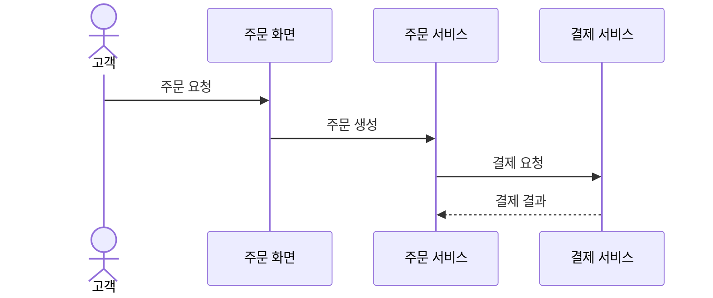
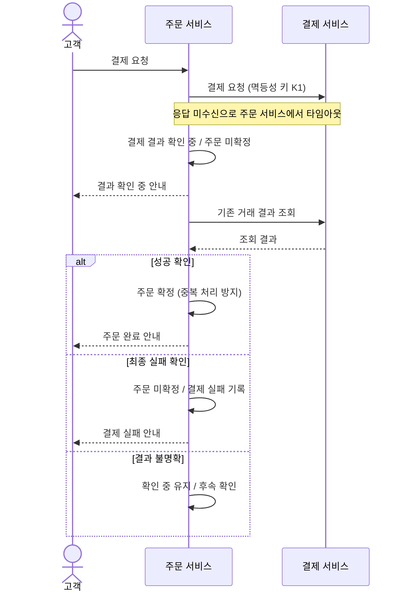
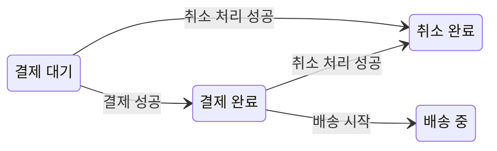

# 소프트웨어 설계

[[00-학습-허브]] · [[04-테스트와-보안]] · [[07-학습-진도]]

## 기능 요구사항과 비기능 요구사항

| 구분 | 묻는 내용 | 온라인 쇼핑몰의 예 |
|---|---|---|
| **기능 요구사항** | 시스템이 **무엇을 하는가?** | 회원 로그인, 주문 취소, 주문 내역 조회 |
| **비기능 요구사항** | 그 기능을 **어떤 품질이나 조건으로 제공하는가?** | 검색 결과를 2초 이내에 표시 |

`검색 결과를 표시한다`는 제공할 기능을 말하고, `2초 이내`는 응답 시간이라는 성능 조건을 말한다. 따라서 `검색 결과를 2초 이내에 표시한다`는 문장에서 확인할 비기능 요구사항은 응답 시간이다. 비기능 요구사항에는 성능 외에도 보안, 가용성 같은 품질 조건이 있다.

`사용자가 주문 내역을 PDF로 내려받는다`는 수행할 **기능**이다. 반면 `월 가동률 99.9% 이상`은 가용성, `저장된 개인정보 암호화`는 보안, `동시 접속 1,000명 지원`은 용량·성능에 관한 **비기능 조건**이다. 요구사항의 문장에 사용자 동작과 품질 조건이 함께 들어갈 수 있으므로, 무엇을 구현하는지와 어떤 조건을 만족해야 하는지 나누어 읽는다.

## UML 유스케이스 다이어그램

**유스케이스 다이어그램**은 시스템 바깥의 **행위자(Actor)**와 시스템이 제공하는 **기능(유스케이스)**의 관계를 나타낸다. 쇼핑몰에서 고객이 상품을 검색·주문하고 관리자가 상품을 등록한다면, 고객·관리자를 행위자로, 검색·주문·등록을 유스케이스로 그린다. "누가 어떤 기능을 이용하는가?"를 물으면 유스케이스 다이어그램을 고른다.

| 다이어그램 | 주로 나타내는 것 |
|---|---|
| 유스케이스 | 행위자와 시스템 기능의 관계 |
| 클래스 | 클래스의 속성·메서드와 클래스 간 관계 |
| 시퀀스 | 객체 사이 메시지가 오가는 시간 순서 |
| 상태 | 객체 상태와 상태 전이 |

## UML 클래스 다이어그램

**클래스 다이어그램**은 클래스의 **이름·속성·메서드(연산)**와 클래스 사이의 관계를 나타낸다. 예를 들어 `회원` 클래스의 속성으로 `회원번호·이름`, 메서드로 `주문하기()`를 적고, `회원`과 `주문` 사이에 관계를 연결할 수 있다. Python의 `class`에 어떤 데이터와 동작이 들어 있고 다른 클래스와 어떻게 이어지는지 보여주는 **정적 구조도**라고 생각하면 된다.

문제에서 "누가 기능을 이용하는가"를 물으면 **유스케이스**, "클래스에 무엇이 들어 있고 서로 어떻게 연결되는가"를 물으면 **클래스**, "객체 사이 요청이 어떤 순서로 오가는가"를 물으면 **시퀀스** 다이어그램이다.

## UML 시퀀스 다이어그램

**시퀀스 다이어그램**은 참여자 사이에 **메시지가 오가는 시간 순서**를 나타낸다. 주문 처리라면 주문 화면이 주문 서비스에 요청하고, 주문 서비스가 결제 서비스에 결제를 요청한 뒤 결과를 받는 흐름을 그릴 수 있다.

요청과 응답의 **순서**를 묻는다면 시퀀스를 고른다. 실제 흐름을 검토할 때는 정상 처리뿐 아니라 결제 실패 응답과 그 뒤 주문 상태 처리도 확인한다.

## 요구사항의 품질과 추적성

요구사항은 이해관계자가 필요로 하는 기능·품질·제약을 합의해 표현한 것이다. 요구사항→설계→구현→테스트로 연결하고 변경 시 영향을 확인한다. 반복 개발에서도 이 관계는 유지된다.

- 명확성: 여러 사람이 같은 의미로 해석할 수 있어야 한다. “빠르게 조회” 대신 처리 시간과 측정 조건을 정한다.
- 완전성: 합의한 범위에서 정상·실패·예외와 필요한 조건이 빠지지 않아야 한다.
- 일관성: 요구사항 사이에 모순이 없어야 한다.
- 검증 가능성: 시험·검토·분석 등으로 충족 여부를 판정할 수 있어야 한다. 모든 요구사항을 숫자로만 표현해야 한다는 뜻은 아니다.
- 추적성: 요구사항의 출처와 관련 설계·구현·테스트를 연결해 누락과 변경 영향을 확인할 수 있어야 한다. 문장 자체의 품질과 구분되는 관리 특성이기도 하다.

예: “주문 조회가 빨라야 한다”는 기준이 모호하다. “지정한 시험 환경에서 동시 사용자 100명, 주문 데이터 100만 건, 10분간 정해진 조회 시나리오를 실행할 때 요청의 95%가 2초 이내 응답해야 한다”처럼 조건·대상·판정 기준을 정한다. 수치는 학습용 예시이며 실제 기준은 이해관계자와 합의한다.

감리에서는 요구사항 정의서의 판정 기준과 승인 이력, 추적표, 연결된 테스트 케이스·결과를 함께 확인한다. 추적표가 있다는 사실만으로 실제 연결의 정확성까지 보장되지는 않는다.

## 성공 테스트만으로 부족한 이유

요구사항 “결제가 성공한 경우에만 주문을 확정한다”에서 핵심 제약은 결제 성공이 아닌데 주문이 확정되는 것을 금지한다는 점이다. 성공 시 확정 테스트만 통과해도 실패 시 확정하는 결함이 남을 수 있다. 예를 들어 결제 결과와 무관하게 항상 주문을 확정하는 구현도 성공 테스트는 통과한다. 추가로 결제 실패 시 주문이 확정되지 않는지 확인한다.

엄밀히 “성공한 경우에만 확정”은 확정하려면 성공해야 한다는 필요조건을 뜻한다. 성공하면 반드시 확정한다는 보장까지 의도한다면 “결제 성공 시 주문을 확정하고, 성공하지 않은 경우에는 확정하지 않는다”처럼 두 방향을 명시한다.

무결성·완전성이라는 추상 표현은 구체적인 검증 대상으로 바꾼다. 이 사례의 무결성은 결제 상태와 주문 상태의 일관성으로 구체화할 수 있다. 요구사항의 완전성(필요 조건 누락 여부), 데이터 완전성(필요 데이터 누락 여부), 테스트의 충분성(필요 검증 누락 여부)은 구분한다. 결제 응답 지연은 곧 결제 실패를 뜻하지 않으므로 처리 정책은 별도로 합의한다.

## 요구사항 추적표의 적용

추적표는 요구사항 ID와 관련 설계·테스트 ID 등을 연결한다. 예: R-01(결제 성공 시 확정, 성공하지 않으면 미확정)→D-01(결과별 상태 처리)→T-01(성공 시 확정), T-02(실패 시 미확정). 연결이 존재하는지와 연결된 검증이 충분한지는 별도 확인한다. 변경 영향은 연결된 항목을 출발점으로 분석하되 추적표 자체의 누락도 점검한다.

### 추적성이 필요한 이유를 서술하기

요구사항 추적성은 요구사항과 관련 설계·구현·테스트의 연결 관계를 관리해 구현·검증 누락을 점검하는 데 필요하다. 요구사항 변경 시 이 연결을 따라 영향을 분석하고 수정·재검증할 대상을 식별한다. 추적성은 테스트 수행 자체와 구분하며, 연결이 있다는 사실만으로 충분한 테스트나 품질이 보장되지는 않는다. 변경과 관련된 산출물을 검토하여 수정 여부를 판단한다.

### 변경 영향 분석과 테스트 갱신

취소 가능 시간을 결제 후 30분에서 10분으로 바꾸면 요구사항 명세서, 해당 시간 조건을 기술한 설계·사용자 안내, 구현 코드·설정, 테스트 케이스와 기대 결과를 검토한다. 인프라 문서는 인프라 구성·설정에 영향이 있을 때 수정한다. 모든 산출물을 일괄 수정하는 것이 아니라 영향을 분석해 수정 대상을 정한다.

15분 후 취소가 허용된다는 기존 테스트는 변경 후 거절을 기대하도록 갱신해야 한다. 시간 한계에서는 경계값 테스트도 유용하다. 예를 들어 “결제 완료 시각 기준 경과 시간 10분 이하만 취소 허용”으로 경계의 포함 여부까지 정하고, 9분 59초·정확히 10분·10분 1초를 검증한다. 실제 시험에서는 판정 시점과 시간 정밀도도 요구사항에 맞춰야 한다.

## 반복 결제 요청과 멱등성

같은 결제 요청을 반복해도 실제 결제 효과가 한 번만 발생하도록 하는 것은 멱등성 적용 사례다. 멱등성은 동일한 연산을 여러 번 적용한 결과가 한 번 적용한 결과와 같다는 성질이며, 응답 문구가 항상 같다는 뜻은 아니다. “같은 요청”의 식별 기준을 명확히 해야 한다. 금액이 같다는 이유만으로 같은 요청으로 보면 별개 구매를 잘못 차단할 수 있다. 예를 들어 하나의 결제 시도에 식별키를 부여하고 재전송 시 같은 키를 사용한다.

순차 반복뿐 아니라 같은 키의 동시 요청도 검증 대상이다. 동시 요청은 두 처리가 모두 미처리로 판단하는 경쟁 상황을 드러낼 수 있다. 식별키만 붙이는 것으로 보장되지 않으며 서버의 중복 처리 통제와 결제 제공자 연동까지 필요하다. 실제 청구 횟수는 결제 거래 기록 등으로 확인한다.

주문 식별자와 결제 시도 식별키는 반드시 같은 값이 아니다. 결제 실패 후 새 결제 시도 등 업무 정책에 맞춰 식별키의 범위와 재사용 조건을 정의한다. 같은 시도의 재전송에는 같은 키를 사용하고, 별개 구매는 구분해야 한다. 서버는 키와 요청 내용의 일치 및 중복 처리를 통제해야 한다.

### 식별키와 멱등성 구현을 답안에서 구별하기

식별키는 요청을 구별하는 수단이며, 키를 부여하는 것만으로 중복 결제를 막지는 못한다. 동일 결제 시도를 재전송할 때는 같은 멱등성 키를 사용하고, 처리하는 서버는 해당 키의 처리 상태·결과를 관리해 추가 결제가 발생하지 않도록 중복 실행을 통제해야 한다. 이미 처리 중이거나 완료된 요청은 그 상태·결과를 반환하는 방식으로 처리할 수 있다. 동시 요청도 중복 실행되지 않도록 해야 하며 결제 제공자의 규약과 연계한다.

처리 방안을 묻는 서술에서는 “멱등성을 보장한다”라는 목표에 키 재사용과 중복 처리 통제라는 방법을 붙인다. 거래 조회용 식별자와 멱등성 키는 구현에 따라 구분될 수 있다.

## 상태와 상태 전이: 결제 응답 지연

상태는 대상이 현재 어떤 상황에 있는지를 나타내고, 상태 전이는 사건이나 조건에 따라 상태가 바뀌는 것이다. 다음은 결제 상태 설계의 예이며 주문 상태와 구분한다.

| 현재 결제 상태 | 사건 | 다음 결제 상태 |
|---|---|---|
| 처리 중 | 성공 확인 | 성공 |
| 처리 중 | 최종 실패 확인 | 실패 |
| 처리 중 | 타임아웃 | 결과 확인 중 |

타임아웃은 정해진 시간 내 응답을 받지 못했다는 뜻이며 결제 실패 확정을 뜻하지 않는다. 결제는 성공했으나 응답만 유실됐을 수 있다. 성공 확인 전 주문을 확정하지 않고, 결제 결과 조회 등으로 상태를 확인하도록 정책을 설계한다. 실제 시스템의 조회·재전송 방식은 결제 제공자 규약과 멱등성 정책에 맞춘다.

감리에서는 요구사항과 상태 설계의 일치, 성공·실패·타임아웃 테스트의 범위 및 수행 결과를 확인한다. 시간 경계가 있는 요구사항은 경계 전·경계·경계 후 테스트의 존재와 실제 결과를 확인한다.

### 타임아웃 이후의 결과 확인과 중복 방지

1. 결제 결과를 단정하지 않고 결과 확인 중 상태로 관리한다.
2. 기존 결제를 식별하는 키로 결제 제공자에 결과를 조회한다. 성공이 확인되면 주문을 확정하고, 최종 실패가 확인되면 주문을 확정하지 않는다. 결과가 계속 불명확하면 후속 조회·운영 확인 정책으로 해결한다.
3. 동일 결제 시도를 재전송할 때는 제공자가 지원하는 멱등성 규약에 따라 같은 키를 사용한다. 응답 유실만을 이유로 새로운 키로 재결제를 시작하지 않는다. 결제 중복 방지와 함께 주문 확정 처리의 중복도 통제한다.

감리에서는 타임아웃·결과 조회·중복 요청 테스트와 수행 결과, 결제 거래 내역 및 주문 상태 이력을 대조한다. 문서상 정책뿐 아니라 실제 중복 청구나 중복 주문 처리가 없는지도 확인한다.

## 시퀀스로 표현하는 타임아웃과 결과 조회

상태 다이어그램은 대상의 상태 변화를, 시퀀스 다이어그램은 참여자 사이 메시지의 순서를 보여준다. 세로 점선은 참여자의 생명선이며 이 예시는 위에서 아래로 메시지 순서를 읽는다. 이 그림에서 실선 화살표는 요청·호출, 점선 화살표는 응답을 나타낸다. `alt`는 조건에 따른 대안 흐름으로 Python의 `if/elif/else`와 비교할 수 있다.

다음은 최초 요청에서 타임아웃이 발생한 경로를 표현한 예다. 정상 응답이 즉시 도착하는 경로와 재전송은 생략했다. 타임아웃은 주문 서비스에서 관찰한 응답 부재이지 결제 서비스가 보낸 실패 응답이 아니다. 조회용 거래 식별자와 멱등성 키는 구분될 수 있다. K1 표시만으로 멱등성이 보장되는 것은 아니며 서버의 중복 처리 통제가 필요하다.

감리에서는 요구사항과 시퀀스의 순서·분기 일치를 확인하고, 관련 테스트 케이스·수행 결과 및 거래·주문 상태 기록으로 구현의 일치도 확인한다.

### 조회 호출 성공·결제 성공과 감리 확인 자료

조회 호출이 정상 처리됐다는 사실과 반환된 결제 상태가 성공이라는 사실은 다르다. 조회가 정상 처리돼도 결제 상태는 실패나 처리 중일 수 있다. 주문 확정 조건은 해당 거래의 결제 성공이 확인되는 것이며, 조회 실패 자체도 결제 실패를 뜻하지 않는다.

멱등성 키 도입과 중복 실행 방지는 구현 방안이다. 구현이 동작하는지 확인할 자료로는 관련 테스트 케이스·수행 결과와 결제 거래 내역·주문 상태 이력이 있다. 식별자는 관련 기록을 연결하는 데 활용하지만 키의 존재만으로 성공 여부나 중복 방지의 동작을 입증하지는 못한다. 예를 들어 결제 실패 조회 결과를 받은 테스트에서 주문이 미확정으로 남았는지 실제 결과와 기록을 대조한다.

## 설계 산출물 간 일관성

상태 설계와 시퀀스 설계는 동일한 업무를 서로 다른 관점에서 표현한다. 상태 설계는 어떤 상태 변화가 가능한지를, 시퀀스는 참여자 사이의 메시지와 처리 순서를 나타낸다. 두 산출물이 같은 요구사항과 상태 전이 규칙을 따라야 한다.

학습용 규칙: “취소 완료 주문은 새로 배송을 시작할 수 없다.”

여기서 허용 여부는 “현재 주문 상태에서 해당 처리를 수행해 상태를 바꿔도 되는가”를 뜻한다. 배송 시작만이 아니라 각 행에 적힌 처리에 적용한다. 아래 표는 성공한 처리의 상태 변화를 단순화한 예다.

| 현재 주문 상태 | 시도하는 처리 | 처리 허용 여부 | 처리 결과의 주문 상태 |
|---|---|---|---|
| 결제 완료 | 배송 시작 | 허용 | 성공 시 배송 중 |
| 결제 완료 | 주문 취소 | 허용 | 성공 시 취소 완료 |
| 취소 완료 | 배송 시작 | 거절 | 취소 완료 유지 |

이 규칙과 달리 시퀀스에서 취소 완료 후 물류 서비스에 배송 시작을 요청한다면 상태 설계와 시퀀스 설계가 불일치한다. 요구사항→상태 전이 규칙→시퀀스의 호출·조건→테스트 케이스와 수행 결과를 대조한다. 실제 적용에서는 취소와 배송의 동시 처리 정책도 별도로 정의해야 하지만 이번 사례는 취소 완료 후 새 배송 요청만을 다룬다.

### 불허 전이를 확인하는 테스트

- 사전 조건: 주문 취소가 완료된 주문을 준비한다.
- 수행: 주문 서비스에 해당 주문의 배송 시작 처리를 요청한다.
- 기대 결과: 요청이 거절되고 주문은 취소 완료 상태를 유지하며, 물류 서비스로 신규 배송 시작 요청이 전송되지 않는다.

이번 규칙의 대상은 주문 취소 완료 상태다. 결제 취소·환불 상태와 주문 취소 상태는 별도로 관리될 수 있으므로 “결제 취소된 건”으로 기준을 바꾸지 않는다. 요청 발생 유무뿐 아니라 발생하지 않아야 한다는 기대 결과를 명시한다.

## 상태 전이 테스트와 커버리지

커버리지는 정해진 기준에서 테스트가 다룬 범위를 나타낸다. 상태 커버리지는 모델의 상태들을 얼마나 방문했는지, 전이 커버리지는 모델의 상태 변화들을 얼마나 실행했는지 확인한다. 아래에서는 전이 커버리지를 허용 전이 기준으로 계산하고, 불허 전이 시도에 대한 거절 테스트는 별도로 다룬다. 상태나 전이를 실행할 때는 기대 상태와 후속 동작이 맞는지도 확인한다.

다음은 주문 상태의 학습용 모델이다. 결제 대기 및 결제 완료 상태에서 취소 처리가 성공하면 주문 취소 완료가 된다고 정하며, 취소 완료 이후 배송 시작은 금지한다. 결제 취소·환불의 세부 흐름과 시간·권한 조건은 이번 모델에서 생략한다.

- T1: 결제 대기→결제 완료→배송 중.
- T2: 결제 대기→취소 완료.

두 테스트가 기대 결과대로 수행되면 상태 4개는 모두 방문하지만 허용 전이 4개 중 3개만 실행한다. 모든 상태의 방문만으로 모든 전이의 검증을 대신할 수 없다. 불허 전이 테스트에서는 금지된 처리를 시도한 뒤 거절·상태 유지·부적절한 후속 동작 미발생을 확인한다. 허용 전이를 모두 실행하더라도 모든 전이 조합·조건·오류까지 검증했다는 뜻은 아니다.

### 불허 전이 테스트에서 무엇을 성공으로 판단하는가

불허 전이 테스트는 금지된 상태 변경을 일부러 요청하여 시스템이 차단하는지 확인하는 테스트다. 앞서 취소 완료 후 배송 요청이 발생하지 않는지 확인한 사례가 이에 해당한다. 취소 완료 주문에 배송 시작을 요청하면 요청 거절·취소 완료 상태 유지·물류 서비스로 신규 배송 요청 미전송이 기대 결과다.

요청 처리의 허용·거절과 테스트의 통과·실패는 구분한다. 기대한 거절과 상태 유지·부적절한 후속 동작 미발생이 확인되면 테스트는 통과한다. 오류 응답을 보냈더라도 실제 배송 요청이 전송됐다면 기대 결과와 다르므로 테스트는 실패다.
