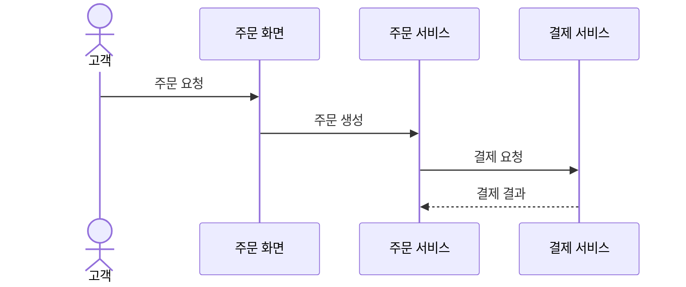

# 소프트웨어 설계

[[00-학습-허브]] · [[04-테스트와-보안]] · [[07-학습-진도]]

## 기능 요구사항과 비기능 요구사항

| 구분 | 묻는 내용 | 온라인 쇼핑몰의 예 |
|---|---|---|
| **기능 요구사항** | 시스템이 **무엇을 하는가?** | 회원 로그인, 주문 취소, 주문 내역 조회 |
| **비기능 요구사항** | 그 기능을 **어떤 품질이나 조건으로 제공하는가?** | 검색 결과를 2초 이내에 표시 |

`검색 결과를 표시한다`는 제공할 기능을 말하고, `2초 이내`는 응답 시간이라는 성능 조건을 말한다. 따라서 `검색 결과를 2초 이내에 표시한다`는 문장에서 확인할 비기능 요구사항은 응답 시간이다. 비기능 요구사항에는 성능 외에도 보안, 가용성 같은 품질 조건이 있다.

`사용자가 주문 내역을 PDF로 내려받는다`는 수행할 **기능**이다. 반면 `월 가동률 99.9% 이상`은 가용성, `저장된 개인정보 암호화`는 보안, `동시 접속 1,000명 지원`은 용량·성능에 관한 **비기능 조건**이다. 요구사항의 문장에 사용자 동작과 품질 조건이 함께 들어갈 수 있으므로, 무엇을 구현하는지와 어떤 조건을 만족해야 하는지 나누어 읽는다.

## UML 유스케이스 다이어그램

**유스케이스 다이어그램**은 시스템 바깥의 **행위자(Actor)**와 시스템이 제공하는 **기능(유스케이스)**의 관계를 나타낸다. 쇼핑몰에서 고객이 상품을 검색·주문하고 관리자가 상품을 등록한다면, 고객·관리자를 행위자로, 검색·주문·등록을 유스케이스로 그린다. "누가 어떤 기능을 이용하는가?"를 물으면 유스케이스 다이어그램을 고른다.

| 다이어그램 | 주로 나타내는 것 |
|---|---|
| 유스케이스 | 행위자와 시스템 기능의 관계 |
| 클래스 | 클래스의 속성·메서드와 클래스 간 관계 |
| 시퀀스 | 객체 사이 메시지가 오가는 시간 순서 |
| 상태 | 객체 상태와 상태 전이 |

## UML 클래스 다이어그램

**클래스 다이어그램**은 클래스의 **이름·속성·메서드(연산)**와 클래스 사이의 관계를 나타낸다. 예를 들어 `회원` 클래스의 속성으로 `회원번호·이름`, 메서드로 `주문하기()`를 적고, `회원`과 `주문` 사이에 관계를 연결할 수 있다. Python의 `class`에 어떤 데이터와 동작이 들어 있고 다른 클래스와 어떻게 이어지는지 보여주는 **정적 구조도**라고 생각하면 된다.

문제에서 "누가 기능을 이용하는가"를 물으면 **유스케이스**, "클래스에 무엇이 들어 있고 서로 어떻게 연결되는가"를 물으면 **클래스**, "객체 사이 요청이 어떤 순서로 오가는가"를 물으면 **시퀀스** 다이어그램이다.

## UML 시퀀스 다이어그램

**시퀀스 다이어그램**은 참여자 사이에 **메시지가 오가는 시간 순서**를 나타낸다. 주문 처리라면 주문 화면이 주문 서비스에 요청하고, 주문 서비스가 결제 서비스에 결제를 요청한 뒤 결과를 받는 흐름을 그릴 수 있다.

요청과 응답의 **순서**를 묻는다면 시퀀스를 고른다. 실제 흐름을 검토할 때는 정상 처리뿐 아니라 결제 실패 응답과 그 뒤 주문 상태 처리도 확인한다.
